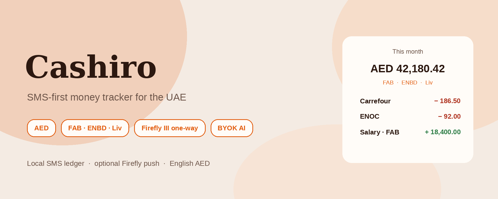

# Cashiro

SMS-first expense tracker for Android with a **two-way, ours-only** sync add-on for your
self-hosted [Firefly III](https://www.firefly-iii.org/) instance. Tuned for UAE banks and AED.

It reads bank SMS on the phone, builds a local ledger, and synchronises it with Firefly III:
push and pull **your own rows only** — Firefly-native transactions are never touched or
imported. Budgets and subscriptions sync two-way too. AI is **not** bundled (no BYOK in
this build).

Built on [PennyWise AI](https://github.com/sarim2000/pennywiseai-tracker) (upstream, merged
continuously) with the fork's Firefly work consolidated as an add-on. Default look follows
Android Material You; default currency is **AED**.

## How it works

1. Grant SMS permission (read-only). No account, no inbox changes, nothing sent.
2. Cashiro parses bank SMS into amount, merchant, category, and date, building a local ledger.
3. Optionally connect a self-hosted Firefly III instance with a Personal Access Token and
   map accounts/categories.
4. Transactions created locally push to Firefly; later edits sync back (two-way, ours-only).

## Firefly III

Opt-in, off by default. **Settings → Firefly III Sync**.

| What | Behaviour |
| --- | --- |
| Direction | Two-way, ours-only (push + pull of owned rows) |
| Lookup | `/search/transactions?query=external_id_is:"pennywise-{transactionHash}"` |
| Missing | `POST` create (Cashiro-owned, `pennywise-` prefix) |
| Already ours | `PUT` update, or `PULL` when the remote row is newer |
| Firefly-native | skipped, logged — never imported, never overwritten |
| Budgets | two-way: push/pull budgets + limits (match by prior id, then name) |
| Subscriptions | two-way: push/pull recurring transactions |
| External IDs | content-hashed (`pennywise-{transactionHash}`) so restores re-link, not duplicate |
| Sync log | in-app log of every create/update/skip/error, with copy/share/clear |
| Token | stored in EncryptedSharedPreferences; never in backups or the app DataStore |

All Firefly sync state lives in an add-on-owned database (`cashiro_firefly.db`) and
preferences store (`cashiro_firefly_prefs`), so upstream updates merge cleanly and never
re-migrate Firefly data. See [`docs/upstream-sync.md`](docs/upstream-sync.md).

## Development

- `./gradlew :app:assembleStandardDebug` — build the debug APK.
- Before touching Firefly code or the seam files, read [`docs/upstream-sync.md`](docs/upstream-sync.md).
- Release: `./scripts/release.sh <patch|minor|major>`.

## License

AGPL-3.0. This is a personal fork; use at your own risk.
